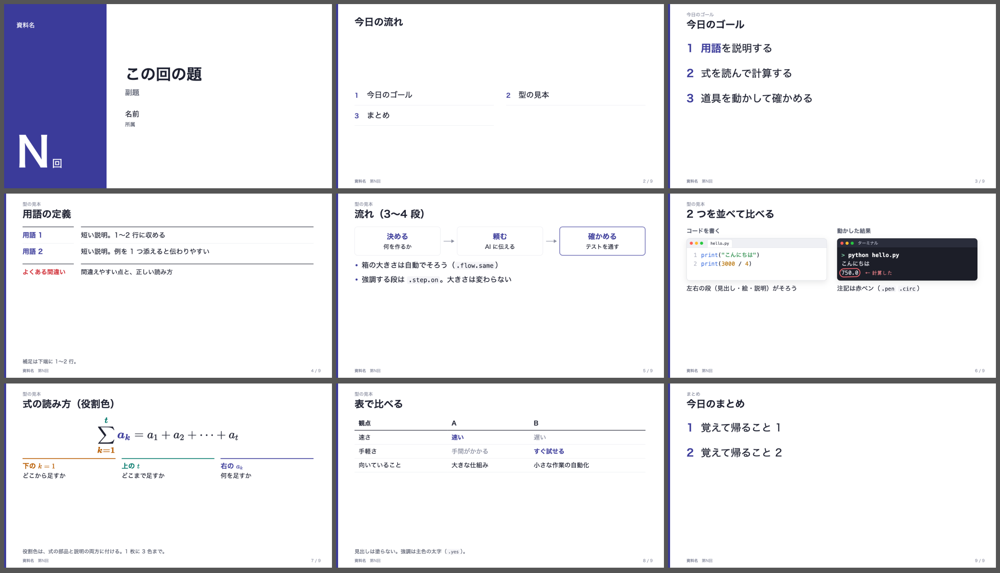

# lecture-slides-skill

講義・発表のスライドを **HTML で作り、PDF にして、機械チェックまで通す** ための、Claude Code のスキルです。



AI にスライドを作らせると、こうなりがちです。

- 文章が AI っぽい（決まり文句、不自然な言い回し）
- デザインが AI っぽい（飾りのアイコン、色の使いすぎ）
- ページごとに文字や枠の大きさがばらばら
- 文字が枠からはみ出す、図が重なる

このスキルは、共通のデザイン（CSS）と、15 種の機械チェックを持っています。エージェントが作ったスライドを毎回同じ基準で調べ、0 件になるまで直させるので、頼むたびに同じ品質で出てきます。

## できること

- 1 枚 = 1280×720 の HTML。PDF に書き出す
- 数式（KaTeX）。式の部品と説明を同じ色で結ぶ「役割色」
- ターミナル・エディタ・ブラウザ・表計算などの画面の絵
- 赤ペンの注記（丸囲み・番号）
- 機械チェック 15 種: はみ出し、重なり、文字の重なり、1〜2 文字だけの行、コードの折り返し、数式の描画漏れ、横に並ぶ枠の高さの不揃い、読めない色、小さい文字、PDF で灰色の四角に化ける影 など

## 必要なもの

- [Claude Code](https://claude.com/claude-code)（スキルに対応したエージェントなら、ほかでも動くはずです）
- [Node.js](https://nodejs.org/)
- Google Chrome か Microsoft Edge（Windows は Edge がはじめから入っています）

Windows・macOS で動きます（Linux も Chrome / Chromium があれば動きます）。

## 入れ方

Claude Code で、スライドを作りたいフォルダを開いて、こう頼みます。

> https://github.com/takazawa/lecture-slides-skill のスキル lecture-slides を、このフォルダに入れてください。

手で入れるなら、このリポジトリの `skills/lecture-slides/` を、フォルダの `.claude/skills/lecture-slides/` に写します。

初めて使うときに、スキルが部品（`engine/`）をフォルダの `slides/` に写し、`npm install` を実行します。

## 使い方

> 来週のゼミで、需要予測の手法を 10 分で紹介するスライドを作ってください。

流れはスキルの中に書いてあります（中身を決める → 1 枚ごとに型を選ぶ → 書く → 推敲 → ビルドと機械チェック → 全ページを目で見る → 数値を確かめる → 別のエージェントに読ませる）。

手で動かすなら:

```bash
node slides/build.mjs <フォルダ>/slides.html        # PDF と機械チェック
node slides/sheet.mjs <ページ画像のフォルダ>        # 9 枚ずつの一覧
```

## 色を変える

既定の主色は紫紺（`#3b3b9a`）です。`slides/deck.css` の `:root` にある `--shikon` と `--rc` を書き換えると変わります。

## 一緒に使うとよいスキル

どれも別の作者のスキルです。入っていれば、このスキルの流れの中で使います。

| スキル | 何をするか | ライセンス |
| --- | --- | --- |
| [yomiyasu](https://github.com/nanaism/yomiyasu) | 日本語の文章の AI っぽさを直す | MIT |
| [consulting-pptx-skill](https://github.com/carnot-tech/jinba-consulting-pptx-skill) | スライドの組み方の規約・図の型・検査 | MIT |
| [unslop](https://github.com/heydamir/unslop) | 見た目の AI っぽさを洗い出し、デザインの方向を決める | CC BY 4.0 |

## 中身

```
skills/lecture-slides/
├── SKILL.md              スキルの本体（流れと守ること）
├── references/
│   ├── design.md         デザインの決まり（色・文字・枠・余白）
│   ├── patterns.md       ページの型と HTML の書き方
│   └── checks.md         機械チェック 15 種と直し方
├── assets/template.html  ひな形（型の見本つき）
└── engine/               プロジェクトの slides/ に写す部品
    ├── deck.css  deck.js  build.mjs  sheet.mjs  package.json
```

## ライセンス

MIT
